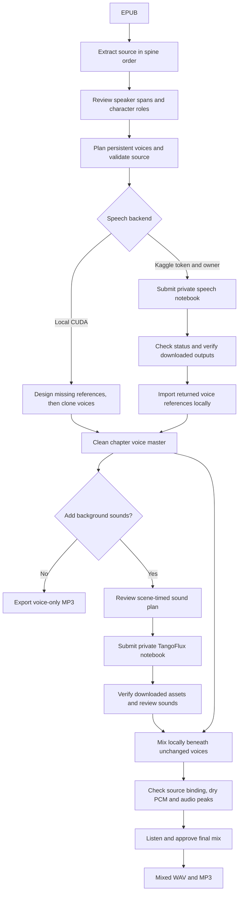

# Ebook → Audio Drama

**The original words. A persistent voice for each person.**

A small, review-first Python workflow for turning an EPUB into a **full-cast, unabridged audiobook** with Qwen3-TTS. It preserves narration and dialogue tags rather than rewriting a novel into a screenplay.

## Workflow



**Review first:** unresolved speakers or changed source/reference hashes block
speech rendering. Each person keeps a saved voice reference across chapters;
matching segment checkpoints let speech rendering resume.

**Kaggle is optional:** local speech rendering is the default. Configure
`KAGGLE_API_TOKEN` plus a notebook owner to submit speech or sound runs. Submission,
status and download are separate commands; voice import, sound review, mixing and
final listening approval are explicit local steps, not automatic consequences of
a completed notebook. Sound notebooks receive only asset IDs, prompts, durations
and seeds—not the book or voice master. A deliberately unreviewed sound mix must
use the explicit draft flag and is not an approved final.

See [Kaggle setup](#optional-kaggle-backend-configure-once-run-from-the-cli),
[casting](docs/CASTING.md) and [background-sound generation and mixing](docs/SOUND_DESIGN.md).

## What it does

- Extracts body text in EPUB spine order, retaining headings and notes.
- Builds quotation-review scaffolds. **It does not guess speakers automatically.**
- Keeps canonical character IDs separate from names, aliases and voice versions.
- Requires a source-supported role and a matching voice description before casting.
- Uses Qwen3-TTS **VoiceDesign → Base voice cloning**, retaining each reference WAV and transcript.
- Checks ordered source spans and hashes before speech generation.
- Saves per-segment audio/checkpoints and chapter-to-voice bindings; resumes matching runs.
- Packages a selected chapter for a **private Kaggle GPU notebook**, including only needed inputs.
- Imports returned voice references without losing other chapters' cast records.
- Packages prompt-only TangoFlux sound generation and mixes scene-timed ambience/Foley beneath unchanged voices; see [background sounds](docs/SOUND_DESIGN.md).

**Status:** initial reference implementation. The underlying approach has been exercised in a separate private pilot/chapter workflow. The original speech workflow passed **13 offline contract tests**; the original public demo has now completed GPU speech and ambience generation, voice import, local mixing and technical audio validation (listening approval remains pending). No book or generated voice samples from that private project are included.

## Listen to the original demo

**[▶ Play the café demo](https://clarencesmith185-ui.github.io/ebook-audio-drama/demo/)** — 10.75 seconds, three original synthetic voices and quiet rain.

[Download voices + rain](https://raw.githubusercontent.com/clarencesmith185-ui/ebook-audio-drama/main/docs/demo/cafe-rain.mp3) · [Download voice-only comparison](https://raw.githubusercontent.com/clarencesmith185-ui/ebook-audio-drama/main/docs/demo/cafe-voices.mp3) · [Transcript and technical checks](docs/demo/)

GitHub README pages do not reliably embed audio players; the listening page provides standard browser audio controls. **Unreviewed experimental draft:** technical audio/source/voice-binding checks passed; listening approval and audible word accuracy remain pending. The mixed audio is a non-commercial research demonstration subject to TangoFlux checkpoint terms, not the repository's MIT code license.

## Quick start: original demo

Python 3.10+:

```sh
python -m venv .venv
. .venv/bin/activate
python -m pip install -e .
epub-drama demo projects/demo
epub-drama validate projects/demo 001 --allow-planned
```

The demo is an original short café scene with three roles. Its voice references are deliberately **planned, not generated**. `--allow-planned` checks the text and casting contracts; it is not an audio-quality or render-readiness claim.

### Optional Kaggle backend: configure once, run from the CLI

No local CUDA GPU is needed. Use Python 3.11+ for the Kaggle client and set your
API token in your shell (the application does **not** read `.env` files):

```sh
python -m pip install -e '.[kaggle]'
export KAGGLE_API_TOKEN='your-token-from-kaggle-settings'
export KAGGLE_USERNAME='your-lowercase-kaggle-username'
epub-drama kaggle-run projects/demo 001 --design-missing
```

That **explicit run command uploads the selected chapter and its voice inputs**
to a new private GPU notebook, then returns a local `receipt.json` path. It
packages and pushes automatically; there is no manual `kaggle kernels push` step.
`--design-missing` permits creating only already-planned voice references.
Account verification, GPU quota and model access still depend on Kaggle; a token
cannot bypass them. Upload only text/recordings you have the rights to use.

To make ordinary `render` use Kaggle, create `projects/demo/execution.json`:

```json
{"backend": "kaggle", "kaggle": {"owner": "your-lowercase-kaggle-username"}}
```

```sh
epub-drama render projects/demo 001 --design-missing
# Explicit override; local remains the default when execution.json is absent:
epub-drama render projects/demo 001 --backend local
```

With a modern token, the owner is just the notebook namespace, not another
credential. Set it once in `execution.json` or `KAGGLE_USERNAME`, or pass `--owner`.
Legacy `KAGGLE_USERNAME` + `KAGGLE_KEY`, `~/.kaggle/kaggle.json`, and
`~/.kaggle/access_token` are supported too (including `KAGGLE_CONFIG_DIR`). Never
put credentials in project JSON, payloads, command arguments or Git. See
[Kaggle's official authentication documentation](https://github.com/Kaggle/kaggle-cli/blob/main/docs/README.md#authentication).

### Retrieve speech or run background-sound generation

```sh
# Use the actual receipt path printed by the run command:
epub-drama kaggle-status /path/to/run/receipt.json
# Once COMPLETE; retrieves audio, manifests and text/log evidence, not caches:
epub-drama kaggle-download /path/to/run/receipt.json

# A source-reviewed sound plan uploads only its prompts, durations and seeds:
epub-drama sound-run examples/sound-plan.json --owner your-kaggle-username
# Or reuse the owner in projects/demo/execution.json:
epub-drama sound-run examples/sound-plan.json --project projects/demo
```

Both commands return immediately after submission. Check status later; there is
no blocking poll loop or automatic scheduler. A unique notebook is created per
run so another chapter/run cannot silently overwrite its source/version. Runs
and receipts default to `$XDG_STATE_HOME/ebook-audio-drama/` (or
`~/.local/state/ebook-audio-drama/`); `--run-dir` selects a new empty directory.
Receipts contain notebook identity, payload hashes and returned version when
available, never credentials. Status is explicitly the latest notebook session,
not proof of a historical version. Downloads verify a run-specific completion
marker before being accepted, hash each downloaded file, and refuse nonempty
destinations. A failure/timeout during upload leaves `PUSH_UNCONFIRMED`; inspect
the receipt's slug on Kaggle before launching again. Do not assume that means no
GPU run was started.

Speech output is usually under `output/epub-drama/project/`. After inspecting the
returned files, merge saved voice references back into the local project:

```sh
epub-drama import-voices projects/demo /path/to/run/output/epub-drama/project
```

Use `--reference-kernel OWNER/PREVIOUS_KERNEL` for larger saved references;
matching reference hashes are checked remotely. Missing/changed references fail
closed. Source remains limited to 1 MB. New Kaggle execution does not automatically
import voices, mix sounds, or approve listening quality. Use the returned assets
with [the local sound-mix workflow](docs/SOUND_DESIGN.md), which preserves dry
voices and requires hash-bound listening approval or an explicit draft flag.

For offline review only, the existing `kaggle-package` and `sound-package`
commands still prepare payloads without uploading or requiring credentials.

### Or use your own CUDA GPU

```sh
python -m pip install -e '.[tts]'
epub-drama voice-design projects/demo narrator-v1
epub-drama voice-design projects/demo maya-v1
epub-drama voice-design projects/demo eli-v1
epub-drama validate projects/demo 001
epub-drama render projects/demo 001
# Use the output path printed by render:
epub-drama mp3 projects/demo/runs/001/RUN_ID/chapter.wav chapter-001.mp3
```

Install a CUDA-compatible PyTorch build for your machine. MP3 export requires FFmpeg. CPU/ARM speech inference is not validated by this implementation. The default 1.7B models follow the upstream API; runtime, GPU memory and throughput depend on hardware and dependency versions. See [Qwen3-TTS](https://github.com/QwenLM/Qwen3-TTS#voice-design-then-clone).

## Use your own EPUB

```sh
epub-drama extract /path/to/book.epub projects/my-book
```

Each EPUB spine document gets a directory under `chapters/`. **A spine document is not necessarily a logical chapter**: front matter, footnotes or a split chapter may occupy separate documents. Review `manifest.json` before rendering. Empty spine documents cannot be rendered.

1. Read the selected `source.txt`; do not rewrite it.
2. Edit `script.json`: assign every quotation to a canonical person ID or narrator if it is a sign/title/written quotation. Review unquoted speech, thoughts, nested quotations and dialogue tags too.
3. Add people to `cast.json` with their role, source evidence and matching voice description. Keep uncertain claims explicit; do not mark a role reviewed until resolved.
4. Record any contextual performance choices in `notes`; never present them as author-supplied speaker labels. Unresolved speaker IDs remain `null` and block rendering.
5. Plan each new voice. Use an original reference transcript in the same language:

```sh
epub-drama voice-plan projects/my-book person_01 person_01-adult-v1 \
  --language Chinese \
  --reference-text '清晨的街道渐渐热闹起来。今天还有许多事情需要弄清楚。'
```

6. Once every span has been checked, set `source_reviewed` to `true`, validate and package/render.
7. Listen and check the audio against the source before treating the chapter as finished.

See [the project format](docs/PROJECT_FORMAT.md), [casting guide](docs/CASTING.md) and [verification notes](docs/VERIFICATION.md).

## Fidelity and scope

“Verbatim” here means **exactly matching the extracted, whitespace-normalized source**, not byte-identical EPUB markup. Extraction joins body text nodes with spaces and collapses Unicode whitespace. It excludes document-head metadata and scripts/styles. This can introduce spacing around inline markup, and ruby pronunciation text or image-only content needs manual review. It does not silently remove narration, footnotes or dialogue tags.

Text equality, valid WAVs and reused reference hashes **do not prove** that TTS pronounced every word, retained the intended emotion or avoided voice drift. Pronunciation review, ASR alignment and listening remain separate tasks.

Not included yet: automatic reliable speaker attribution, a review GUI, automatic ASR-based repair, background-music generation, M4B export or an automatic live-log monitor. Speech stays in a clean stem so atmosphere can be mixed later without regenerating voices.

## Background sounds

See [the sound workflow](docs/SOUND_DESIGN.md) for private Kaggle generation, safe waveform saving, hash-bound asset review, scene timing, non-destructive mixing and louder-background revisions. Audio dependencies are optional: `pip install -e '.[sound]'`.

## Development

```sh
python -m pip install -e .
python -m unittest discover -s tests -v
```

CI runs offline contract tests on Python 3.10 and 3.12. GPU dependencies are imported only by GPU commands. Tests cover source fidelity, unresolved speakers, role review, reference tampering, cross-person voice ownership, EPUB spine order, scoped packaging and safe reference import.

## License

Code and the original demo: **MIT**. Model weights and third-party packages retain their own licenses; see [THIRD_PARTY.md](THIRD_PARTY.md). Supply text and reference audio you are entitled to process and publish. Project data, EPUBs, credentials and generated audio are ignored by default and are not part of this release.
